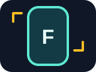

<div align="center">




[](LICENSE)
[](https://github.com/CyberLoop-dev/favicon-forge)
[](https://github.com/CyberLoop-dev/favicon-forge/stargazers)
[](https://github.com/CyberLoop-dev/favicon-forge/commits/main)

**Create a matching SVG and PNG favicon in seconds.**

</div>

## 🧭 Overview

Favicon Forge is a small, local-first utility. Create a matching SVG and PNG favicon in seconds. It runs on your machine and does not require an account or hosted service.

## ✨ Features

- ✨ Generate SVG favicons from initials or a short symbol.
- ✨ Choose foreground, background, shape, and text size.
- ✨ Export SVG and raster PNG versions.
- ✨ Copy a ready-to-use HTML favicon link.
- ✨ All image generation happens locally in the browser.

## 🎬 Demo

Start the local server, customize the icon, then export SVG or PNG. The PNG export uses the browser Canvas API.

## 🚀 Quick Start

```bash
npm start
```

## 🧰 Tech Stack

- 🟢 Node.js built-in HTTP server and browser-native SVG, Canvas, HTML, CSS, and JavaScript
- 🧱 Small, readable source files
- 🔒 Local processing with no telemetry

## 🗂️ Folder Structure

```text
favicon-forge/
├── public/
│   ├── index.html
│   ├── styles.css
│   └── app.js
├── assets/icon.svg
├── server.js
├── package.json
└── README.md
```

## 🗺️ Roadmap

- [ ] 🧪 Add focused automated tests
- [ ] 🧩 Add more presets based on feedback
- [ ] 📦 Publish a versioned release

## 🤝 Contributing

Issues and pull requests are welcome. Include a clear reproduction and keep changes focused.

## 📄 License

MIT — see [LICENSE](LICENSE).

<div align="center">

</div>
